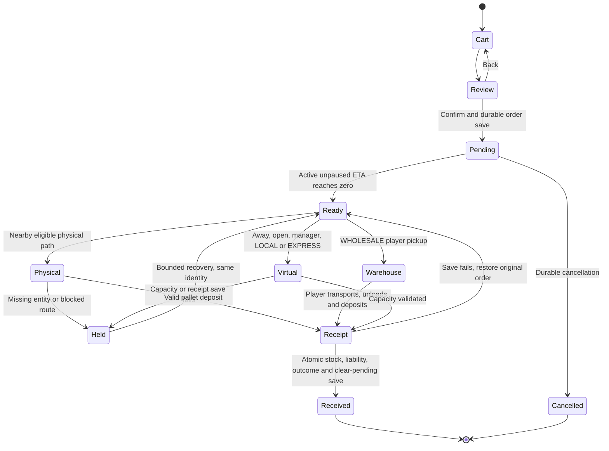
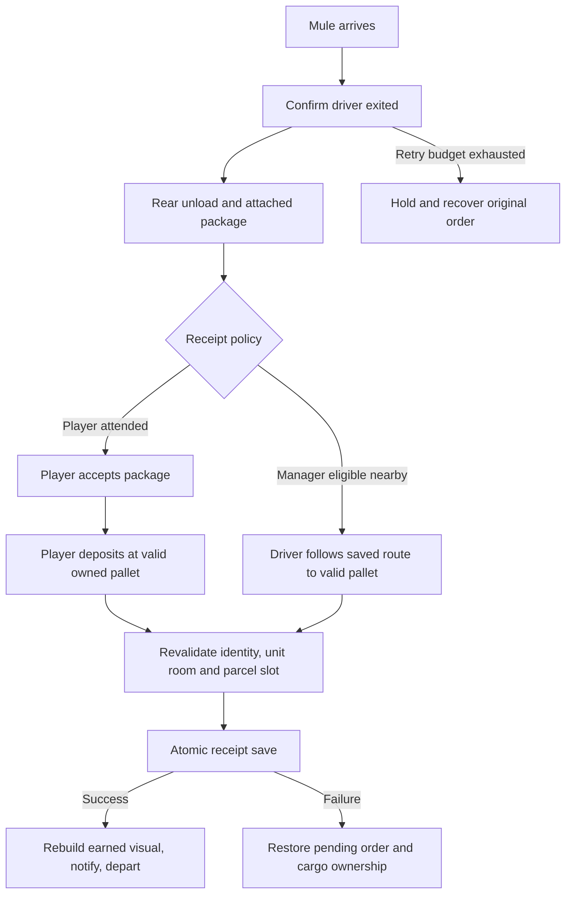
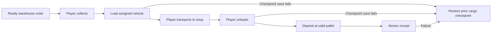
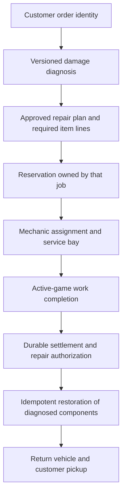

# Glass Heroes v0.3.4 — Preproduction Implementation Proposal (Revision 2)

**Architecture proposal for ShaggyOS Dev Team approval — planning only**  
Prepared 2026-10-24 against the new owner preproduction brief. This revision supersedes the earlier proposal for review. No gameplay implementation, branch creation, release, or installation is authorized by this proposal.

## 1. Audited planning baseline and acceptance gate

The earlier owner “yes” allowed use of v0.3.3.6 RC1 for architecture planning. The newer preproduction brief explicitly states that RC1 GTA testing is ongoing. Accordingly, this revision treats the commit below as the audited planning reference, assumes its intended systems for design, and does not claim gameplay stability. Before implementation, obtain the owner’s final accepted commit and source hash. If that differs, re-audit the delta and rebase the proposal before creating a branch.

- Repository: ShaggyDOS/GTAV_Mechanic_Shop_Script.
- Branch: `feature/shvdn3-336-service-recovery-business-polish`.
- Commit: `c8617aed5cda492214bbbe1907042bcafbfa0dc1`.
- Source SHA256: `7fff30978e2dc4c3235656f6ca6865506d5cea53387b7eb6d83654d71c8a9d6b`.
- Source: `experimental/shvdn3/Install/scripts/GlassHeroesBusiness.3.cs`.
- Project: `experimental/shvdn3/VisualStudio/GlassHeroesBusiness.V3.Experimental.csproj`.
- Established build: .NET Framework 4.8 / C# 7.3 / SHVDN3 3.6.0 references.
- Owner runtime target: GTA V Legacy 1.0.3889.0, SHVDN Enhanced 3.9.0.6, Glass Heroes + Los Santos RED.
- Historical baseline verification: 762/762 behavior tests, 21/21 static checks, Release build with zero errors and two inherited warnings. These are existing baseline results, not tests rerun for this planning document.

The baseline worktree was clean during this audit. Source and saves were not edited. A new implementation branch must wait for both approval of this plan and confirmation of the final accepted baseline; its eventual parent must be that exact commit, not an independently advancing branch tip.

Reviewed [Issue #24](https://github.com/ShaggyDOS/GTAV_Mechanic_Shop_Script/issues/24) and [Issue #25](https://github.com/ShaggyDOS/GTAV_Mechanic_Shop_Script/issues/25), including historical discussion. Issue #24’s old void-save concern is superseded by the current boolean, atomic save implementation. Issue #25’s original single-unit retail scope is superseded by approved v0.3.3.6 quantity sales. Neither historical description warrants downgrading current functionality.

## 2. Existing subsystem inventory

All line references below refer to the pinned baseline source. [Open pinned source](https://github.com/ShaggyDOS/GTAV_Mechanic_Shop_Script/blob/c8617aed5cda492214bbbe1907042bcafbfa0dc1/experimental/shvdn3/Install/scripts/GlassHeroesBusiness.3.cs).

| Subsystem | Existing implementation / source reference | Planning implication |
|---|---|---|
| Inventory | `_parts`, `_specialStock`, `_stockNames`, lines 400–408 | Keep four existing buckets; no replacement inventory ledger. |
| Reservations | `UnreservedRepairStock`, line 5423 | Already accounts for accepted repair commitments across physical, remote and autonomous work; reuse its deduplication and universal substitution rules. |
| Cost estimates | `EstimatedUnitAcquisitionCost`, line 5380 | Estimates are not weighted historical acquisition cost or audited cost of goods sold. Label them accurately. |
| Quantity retail | `TrySellParts`, line 7814; sale review around 7879 | Already validates unreserved stock, applies one batch and rolls back failed saves. Preserve pricing, cash/revenue separation and earned props. |
| Save transaction | `TryCommitBusinessSave`, line 7902; `PrepareFinanceCommit`, 8113; `Save`, 8120 | Writes a complete temporary snapshot and atomically replaces the save; FinanceV1 publication follows durable success. Extend this boundary, not a parallel journal. |
| Order model | Fields around 414–420; `TryPlaceSupplierOrder`, 9244 | One pending purchase order with four line quantities, frozen supplier/cost and active-game ETA already exists. |
| Cart and quote | `SupplierCartCost`, 9235; `ExecuteSupplierCart`, 9344 | Mixed-item cart already exists. Add review/confirmation and clearer presentation. Preserve rounding, supplier pricing and manager discount. |
| Order persistence | `LoadSupplierOrderLines`, 9310; `WriteSupplierOrderLines`, 9329 | SupplierOrderV1 validates against legacy Purchasing fields. Preserve legacy single-item and prepaid interpretation. |
| Delivery scheduler | OnTick around 949–1020; `ProcessSupplierDelivery`, 8852 | Uses active, unpaused game time; no offline ETA catch-up. Retain scheduler and bounded retry cadence. |
| Physical delivery | `StartMuleDelivery`, 8517; rear unload 8622; driver box 8636; walking 8657 | Existing truck/driver/crate choreography should be refined, not replaced. |
| Manager receipt | `ManagerSupplierEligible`, 8742; `TryManagerSupplierDeposit`, 8768 | Nearby automatic pallet deposit and offsite virtual LOCAL/EXPRESS receipt already exist. WHOLESALE remains excluded. |
| Receipt transaction | `CommitSupplierDelivery`, 8794 | Applies mixed lines, provenance and invoice liability, clears pending order, saves, then finalizes visuals/notification. |
| Recovery / cancellation | `RecoverSupplierShipment`, 9052; `TryCancelSupplierOrder`, 9103 | Keep original order through recovery; cancellation refunds only legacy prepaid orders. |
| Storage | Capacity/helpers around 9130–9161; pallet menu 9170; layout 9489–9574; visuals 9843 | Four pallets maximum; 25 units and nine historical parcel slots per placed pallet. Unit capacity and display-slot capacity are independent. |
| Player cargo | `TrySupplierPackageInteraction`, 9614 | Existing warehouse, assigned vehicle, carrying and deposit workflow is authoritative. |
| Current status UI | `ShowSupplierDeliveryStatus`, 8442; detailed inventory 9201 | Status is an on-demand snapshot; completion count is not a durable, identified last-receipt record. |

### Audit findings and confidence

**High confidence — source-established:** mixed orders, batch retail, reservations, manager receipts and atomic final receipt already exist. The milestone should improve their integration and visibility.

**High confidence — source-established:** nine small completed receipts can exhaust a pallet’s parcel slots while units remain below 25. Selling or consuming stock preserves earned boxes. The UI must expose both constraints; it must not clear historical boxes to manufacture space.

**High confidence — source-established, runtime consequence unproven:** driver-exit stage recovery can advance to rear unloading after its timeout without verifying the driver is actually out. Rear unloading/box attachment also do not independently enforce exit completion. This is a candidate for bounded stage validation and GTA reproduction, not a proven explanation of every stalled delivery.

**High confidence — source-established, exploit/reproduction unproven:** receipt identity is optional in `CommitSupplierDelivery`; the physical manager path supplies it, but some player/virtual paths do not. Finalization should require the captured order identity on all paths, including legacy identity zero.

**High confidence — source-established:** some intermediate wholesale cargo saves and pallet purchases ignore `Save()` failure. Final receipt has rollback, but intermediate flags/visuals deserve failure-injection tests and focused rollback if confirmed. Do not describe the entire save system as non-atomic.

**High confidence — source-established:** eligibility currently means pending LOCAL/EXPRESS, manager hired, business open and shop placed. It does not require a streamed manager ped, at-post animation or a new wage-status gate. Any change to that business rule requires explicit scope approval.

**Not established:** a current duplicate receipt, missing invoice, or delivery accounting defect solely from an old pending notification. Compare persistent identity, saved stock and invoices before attributing causality. No crash cause is established by this audit.

## 3. Smallest safe architecture

Keep the existing script and scheduler. Add small read-only inventory/order summaries and narrowly scoped transaction checks. Do not introduce a new economy engine, background worker, independent stock store, dynamic prices, or multiple simultaneous orders.

### Inventory projection

For each existing category show:

- **On hand:** current stored bucket quantity.
- **Reserved:** on hand minus the corresponding result from `UnreservedRepairStock(null)`.
- **Available:** that helper’s per-bucket result, recomputed at sale confirmation.
- **Incoming:** the pending order’s matching line, or migrated legacy single-item quantity; never usable before receipt.
- **Estimated unit cost:** existing estimate, explicitly labelled. Do not imply FIFO/weighted stock valuation.
- **Shared storage:** used units / placed-pallet capacity, free units, pending-order projected headroom and free parcel slots.

Capacity is shared, not four independent capacities. Incoming is a forecast, not physical stock or an extra reservation ledger. Never sum service-specific “dedicated + universal” availability across categories; that can count universal stock repeatedly.

Use existing reorder thresholds. Recommend `max(0, target - available - incoming)` per bucket as a planning aid, subject to cart limit and capacity at confirmation. Show reservations so the recommendation is explainable. Do not automatically buy or reserve incoming inventory for new jobs.

### Purchase and outcome projections

Reuse the existing four-line cart and pricing functions. The review page snapshots displayed quantities/supplier/quote; confirmation revalidates the snapshot, one-pending-order rule, capacity and wholesale assigned vehicle. No invoice or stock is posted on cart creation or confirmation for normal unpaid orders.

Active Orders should distinguish: preparing/ETA, arriving, driver exiting, rear unloading, carrying, awaiting player, player cargo, manager pallet drop, blocked/held, and durable final receipt. Show a compact order identifier with a detail view of the full persistent identity, supplier, lines, ETA and blocking reason.

A proposed **additive `SupplierOutcomeV1` record** stores only the most recent durable terminal outcome: order identity, received/cancelled state, four lines, quantity, cost, prepaid status, actual invoice accrual, active-game timestamp and pallet slot where applicable. Write it in the same snapshot as stock/liability/pending-order changes. Missing history remains “not recorded”; do not fabricate historical identities from aggregate completion counts. This metadata needs plan approval before implementation.

FinanceV1 transaction identities and supplier order identities are different namespaces. Do not present a guessed one-to-one link. If explicit ledger correlation is approved, add a backwards-compatible reference deliberately and test it; do not rewrite old FinanceV1 transactions.

Order UTC ticks remain an opaque legacy identity, never an elapsed-time source. Require an explicit expected identity at receipt entry, even if zero is a valid legacy value. Recovery retains identity. An optional persisted last-issued identity could prevent identity reuse after system-clock rollback; defer that metadata unless approved and validated against existing ID constraints.

## 4. Menu hierarchy and interaction

Retain existing F2 entry points and point editors. Suggested structure:

```text
Business Management
  Inventory & Suppliers
    Inventory Overview
      Category details: on hand / reserved / available / incoming / estimate
      Storage summary and low-stock recommendations
    Build Supplier Order
      Choose Supplier (Wholesale / Local / Express)
      Four existing quantity controls
      Fill Low Stock / Clear Cart
      Review Order
        Supplier, all lines, quantity, quote, ETA, capacity, receipt method
        Confirm Purchase / Back to Cart
    Active Orders
      Current order: identity, lines, live stage, ETA, hold reason
      Recover Shipment / Cancel Order (separate explicit confirmation)
      Last Receipt or Cancellation (durable, read-only)
    Parts Sales
      Existing quantity selection / preview / confirmation
    Stockroom & Pallets
      Unit capacity / parcel slots / existing pallet actions
    Supplier Settings
      Existing configuration and link to existing placement editors
```

Back returns to the actual calling page with selection retained where practical. Supplier selection returns to the cart; review Back preserves the cart; cancellation Back does not mutate the order. Detail pages never save just because they were opened. Use short right-column values and explanatory footers instead of long clipped strings. Test keyboard, controller, native pause, and return from a point editor. Existing centralized Placement Settings remains authoritative; link to its editors without duplicating placement state.

### Attended versus manager policy decision

Current hired-manager behavior prefers eligible automatic receipt. Without a manager, disabled/unconfigured physical delivery can use legacy direct receipt. Therefore the requested attended chain is not currently an unconditional policy.

Recommended default: preserve existing automatic policy and require valid configured physical delivery for a deliberately selected attended workflow. If an explicit per-order “player attended” override is desired, approve its minimal persistence and UI before coding. Do not silently remove legacy behavior or force all hired-manager orders into player handoff. WHOLESALE is always player operated.

## 5. State diagrams

These are proposed logical states layered over existing fields; they do not mandate a replacement persisted stage machine.

### Order lifecycle



### Physical ownership and stockroom



### Wholesale ownership



No manager branch enters this wholesale flow. Reload reconstructs from persisted checkpoints; it does not grant stock based on an absent crate or elapsed real time.

## 6. Receipt, finance and failure boundaries

All player, nearby-manager and remote-manager paths must reach one receipt operation:

1. Validate pending identity, all lines, eligibility, ownership, capacity, pallet slot and checked arithmetic.
2. Snapshot every changed field, including proposed last outcome and FinanceV1 preparation inputs.
3. Apply all inventory lines exactly once; accrue supplier liability only for non-prepaid orders; preserve provenance; clear the pending order; record terminal outcome.
4. Call the existing atomic `Save()` once. On failure restore every changed in-memory field, keeping the original order recoverable.
5. Only after success notify, detach/delete transient entities, update earned visuals and begin departure. A later native/prop failure may reconstruct visuals; it must never repeat stock/invoice posting.

Supplier receipt is normally **inventory plus unpaid liability**, not a cash payment. Paying the invoice is a separate actual cash outflow. Legacy prepaid receipt must not accrue that liability again. Cancellation refunds only an actual prepaid amount and only after a durable cancellation; unpaid orders have nothing to refund.

Retail remains one batch transaction, revalidating current available stock at confirm. Reservations and finance categories remain authoritative. Preserve repair exactly-once settlement and avoid adding remote revenue to totals that already include it.

Test intermediate wholesale cargo and pallet-purchase saves before changing them. If failure leaves memory ahead of disk, use focused snapshot/rollback around that existing transition. Do not replace the established persistence framework. Validate totals/refunds/liability with wider or checked arithmetic before mutation; never silently clamp or discard old balances to make a save fit.

## 7. Persistence and migration

| Existing data | Compatibility requirement |
|---|---|
| Business parts/cash/retail totals; DetailedInventory Stock0–2 | Keep names and meanings; no recalculation from visual props. |
| Purchasing supplier, DeliveryKind/Quantity/Supplier/Cost/Prepaid, DeliveryDueUtcTicks, DeliveryRemainingGameSeconds, CompletedDeliveries | Preserve legacy single-item fallback, opaque ID and saved remaining active ETA. No UTC catch-up. |
| SupplierOrderV1 Version, Line0–3, OrderTicks, Cost, Supplier | Preserve consistency checks and atomic mixed-line receipt. |
| Storage OwnedPallets, BoxCount1–4, DeliveredPackageMask1–4 | Preserve earned history and ownership. Do not free slots merely because units were sold/consumed. |
| Cargo flags and assigned vehicle | Preserve wholesale checkpoints and player ownership across interrupted sessions. |
| BusinessBills SupplierInvoicesDue; FinanceV1 | Preserve accrued liabilities versus cash settlement and current journal records. |
| RepairPromisesV1; employee progression/wages | No migration or rewriting. |
| Saved supplier/warehouse/pallet/driver-route points, XYZ/headings/Set | No renaming, resetting, coordinate migration or placement-engine redesign. |
| Existing supplier settings and Purchasing ReorderThreshold | Reuse values and bounds; no new expense formulas. |

Only approve additive metadata when necessary. Absent outcome records default to unknown history. Mismatched existing pending-order metadata must retain the current fail-closed handling rather than silently crediting or discarding cargo. If old stock exceeds present capacity, preserve stock and explain that new receipts are held; do not delete inventory.

Before any eventual RC installation, back up the complete business-data directory, including Save.ini, Settings.ini, FinanceV1-related data and logs as applicable, together with the matching script. Never alternate builds against an already modified sole save. Rollback restores the matching complete backup and baseline script, not an individual Save.ini copied into newer companion data.

## 8. Recovery and performance constraints

- Confirm driver exit before walking/attaching a box. Use bounded task retries, stage deadlines and an explicit held reason. When recovery fails, preserve the original order. Do not teleport occupied vehicles or manipulate unrelated actors.
- Retain the same physical/away distance boundary so no intermediate range strands a delivery. Preserve player-carried package ownership when moving away; virtual receipt cannot take it over.
- Nearby manager receipt must validate the pallet again at commit. Offsite simulation must not require a streamed physical manager ped.
- Keep one pending order, one delivery truck, one driver and one in-flight package, plus existing warehouse visuals. Keep four pallet and 36 earned-package limits. No decorative carton-per-category expansion in this milestone.
- Reuse the existing roughly one-second supplier cadence and active-time clock. Cache read-only menu summaries; recompute authoritative availability on confirmation. No per-frame storage scans, repeated model requests or per-Tick diagnostic logs.
- Preserve existing bounded model/entity/visual retries and cleanup. Log only transitions, identity, reason, recovery and commit outcome; avoid journal duplication and sensitive paths.
- Existing UTC-named synthetic supplier timers are not evidence of offline progression. Keep ETA tied to saved remaining active-game seconds. Pause, closed GTA and save reload add zero delivery progress.

## 9. Risks and containment

| Risk | Impact | Containment / required proof |
|---|---|---|
| Double-counted universal availability | Reserved parts sold | Reuse per-bucket reservation projection; test concurrent accepted jobs and sale confirmation. |
| Stale callback for previous order | Wrong order credited | Required captured identity on every receipt path; test order A completion/cancel then order B. |
| Save failure between cargo checkpoints | In-memory/disk divergence | Failure injection and rollback/reconstruction at each transition. |
| Save succeeds, visual native fails | Repeated financial receipt | Durable outcome and pending-clear authoritative; visuals reconstruct without posting. |
| Free units but no parcel slots | Unexpected held order | Show both capacities; preserve earned boxes; defer visual-history policy changes. |
| New manager gates alter operation | Regression of successful offsite deliveries | Keep existing eligibility by default; approve semantic changes separately. |
| Driver still seated at rear-unload transition | Stalled choreography | Confirm state, bounded recovery; GTA reproduction before claiming a root cause. |
| Old prepaid/mixed pending saves | Duplicate charge or lost order | Legacy fixtures, no repricing, atomic load/save and failure tests. |
| Changing baseline during work | Unreviewed regressions | Pin accepted commit and compare source hash before branch creation. |
| Unrelated crash investigations | False stability claims | Track CLR stack overflow, startup access violation and Read-only/EUP separately. |

If a phase regresses durability or compatibility, stop that phase and retain the preceding tested commit. Do not use destructive repair utilities, delete pending orders, reset stock, or force-save a guessed state.

## 10. Proposed focused commits and complexity

These are future boundaries, not actions already taken. Tests accompany each change; Commit E is combined regression coverage, not the first testing step.

| Commit | Scope | Estimated complexity / dependencies |
|---|---|---|
| A | Read-only inventory projection, dual capacity display, reservation-aware recommendations, accurate labels | Low–medium. Depends on pinned reservation semantics; no schema change. |
| B | Supplier selection/review/confirm, Active Orders live state, existing menu/controller integration | Medium. Reuse cart; outcome display depends on approved metadata in C or shows only current order. |
| C | Required receipt identity, approved terminal outcome persistence, intermediate-save rollback, bounded physical exit/rear/pallet validation | High. Highest durability and GTA choreography risk; split into smaller reviewable commits if needed. |
| D | Integrate existing nearby/offsite manager paths with C, explicit hold reasons and approved attended policy | Medium–high. Depends on C; no wholesale automation or duplicate receipt implementation. |
| E | Combined inventory, finance, fault-injection, reload and navigation regression suites | Medium–high. Retain and extend inherited tests continuously. |
| F | Release build verification, source manifest, changelog, Word/PDF developer guide and GTA checklist | Medium. Depends on all phases and owner approval for any later RC. |

No elapsed-time estimate is promised before confirming the policy decisions and runtime repro effort. Physical recovery acceptance depends on owner GTA sessions, not compilation alone.

## 11. Automated validation plan

Rerun inherited behavior/static suites and genuine net48/C# 7.3 Release compilation after implementation. Report actual counts and warnings; do not reuse historical counts as new results.

| Area | Required cases / assertions |
|---|---|
| Inventory | Four buckets; dedicated/universal substitutions; multiple accepted physical/remote/autonomous jobs; deduplication; zero stock; incoming excluded; available nonnegative. |
| Retail | Multi-category batch, edit/cancel/confirm, stock changes while preview open, full reserved stock, checked totals, failed save, reload; no invoice reduction or earned-box deletion. |
| Orders | All suppliers; mixed lines; existing pricing/rounding; max quantity and one-pending rule; review Back; insufficient capacity; assigned wholesale vehicle. |
| Legacy saves | Single-item prepaid and unpaid pending orders; SupplierOrderV1 mixed orders; empty/unknown outcome; malformed identity/line mismatch; over-capacity stored stock preserved. |
| Receipt identity | Duplicate same-order callbacks; cancelled A then B; completed A then B; legacy zero identity; offsite/physical transition; recovery retains identity. |
| Atomicity | Inject failures before snapshot write, during write, before replace and at replace; reload original complete state. After successful replace and interrupted visuals, reload committed state with no second credit. |
| Checkpoints | Wholesale load/unload/carry and pallet purchase save failures; restore both cash/cargo flags and coherent visuals. No manager warehouse completion. |
| Capacity | Unit-full, parcel-full, unplaced/unowned pallet, missing support, capacity changed before deposit, mixed order all-or-nothing. |
| Manager | Hired/open/placed eligibility, closed business, manager removal, near/away boundary both directions, player carrying, unconfigured physical route, full pallet, retry exhaustion. |
| Finance | Receipt accrues liability without cash debit; prepaid receipt no second liability; bill payment actual cash debit; unpaid cancel no refund; prepaid cancel one refund; parts retail separate from repairs. |
| Income regression | $5,000 remote sales without outflows gives $5,000 cash increase; with payments, reconcile opening + inflows − outflows = closing; remote subset not counted twice. |
| Time | Pause for longer than ETA; close/reload after long wall-clock delay; system clock changes; business closed; zero offline/paused delivery progress and preserved active-time semantics for all existing income. |
| Navigation | Every changed page forward/Back, keyboard/controller, native pause, return from point editor, no mutation from browsing; no right-column clipping at supported UI scales. |
| Bounds | Missing ped/vehicle/crate, blocked route, failed model load, streaming transitions, repeated recover requests; entity and retry caps remain bounded. |

## 12. Controlled GTA acceptance checklist

Use the owner’s Legacy/Enhanced/LSRED configuration. Restore a complete disposable copy of the accepted baseline business data for each controlled comparison. Record source SHA256, script startup identity, runtime/mod versions and backup identity. Install exactly one Glass Heroes script. Keep the sole original data and live installation untouched during development.

- [ ] Verify all four inventory rows, actual repair reservations and incoming lines against saved values.
- [ ] Exercise purchase review, quantity changes, supplier changes, Back, cancellation and recovery on keyboard/controller.
- [ ] Receive a local and Express order as an attended player: arrival, confirmed exit, rear unload, carry, handoff, saved pallet deposit, single receipt notification and departure.
- [ ] Repeat with manager nearby; then cross the near/away boundary in both directions while the order is ready and while carrying.
- [ ] Test blocked rear access, blocked route, missing driver/vehicle and absent/full pallet. Order remains recoverable with a useful reason.
- [ ] Complete wholesale warehouse pickup with assigned vehicle, save/reload at load/unload checkpoints, and deposit manually. Manager never collects it.
- [ ] Verify a mixed order increments every bucket once, one invoice accrual, no immediate unpaid invoice cash debit, and a durable identified final receipt.
- [ ] Inspect stock and invoice values before/after reload; distinguish pending identity from last completed identity.
- [ ] Sell quantities while repair reservations exist; verify reservations, repair settlement and earned boxes remain intact.
- [ ] Fill parcel slots with small deliveries and confirm the explicit hold despite remaining unit headroom.
- [ ] Pause beyond ETA and reload after a long closed-game interval. No catch-up or paused income/delivery progress.
- [ ] Run extended customer/mechanic operations, transfer modes, wages, finance views and saved placements with LSRED. Record performance and entity cleanup.
- [ ] Check unexpected initialization/save errors and keep crash families separate; one crash-free session is not a stability guarantee.
- [ ] Restore the entire matching baseline backup and script to prove rollback before accepting a release candidate.

## 13. Decisions required before implementation

Final baseline confirmation remains a gate under the latest brief. Review decisions are:

1. Confirm the final accepted v0.3.3.x commit/source hash after owner RC1 testing, and approve this additive scope with one pending mixed purchase order and unchanged prices.
2. Approve preserving automatic manager behavior by default, and decide whether an explicit attended per-order override belongs in this milestone.
3. Approve a bounded additive last-outcome record and mandatory receipt identity; decide separately whether monotonic identity metadata or explicit FinanceV1 references are necessary.
4. Approve showing existing parcel-history limits without deleting/rotating earned boxes. A different visual-capacity policy needs its own design.
5. Keep current manager eligibility unless the owner defines additional operating requirements. Do not infer wage or streamed-ped gates.

Only after plan approval and final baseline confirmation should a new branch be created from the pinned accepted commit. No implementation or release approval is implied by this document.

## 14. Deferred scope

Multiple simultaneous orders; new inventory categories; dynamic supplier/retail pricing; stock-lot valuation and COGS accounting; autonomous retail; customer delivery missions; manager wholesale collection; v0.4 tablet; decorative cartons per category; increased entity caps; automatic removal/rotation of earned boxes; unrelated placement-engine, mechanic or crash-forensics rewrites. Existing financial features, employee systems and crash instrumentation remain preserved.


## 15. Consolidated gap analysis and player examples

| Area | Working baseline capability | Necessary v0.3.4 work / boundary |
|---|---|---|
| Four-category stock | Universal, filters, brake kits, diagnostic supplies; reserved accepted quotes | Richer read-only presentation and integrated recommendations; do not replace counters. |
| Purchase cart | Mixed quantities, supplier cost calculation, one pending order, durable placement | Clear supplier comparison, dedicated summary and explicit confirmation. No new expense formula. |
| Deliveries | Local/Express physical and manager virtual paths; player wholesale cargo | Validate stages and ownership; improve recovery and live explanations. No new delivery engine. |
| Pallets | Saved headings, aligned layouts, earned masks and bounded props | Explain unit/parcel capacity separately; validate deposit/support. No automatic history deletion. |
| Invoices | Final receipt accrues unpaid liability; bills settle separately | Display order/outcome evidence and prevent confusion between invoice accrual and cash payment. |
| Retail | Quantity selection, preview, atomic sale, reservation checks | Integrate inventory/reorder views; preserve current prices and finance treatment. |
| Manager operation | Existing remote income and eligible supplier receipts | Reuse current eligibility/time gates and shared receipt boundary. Optional receipt policy requires approval. |
| Persistence | Atomic complete save, FinanceV1, repair promises, SupplierOrderV1 | Narrow intermediate rollback improvements and approved additive outcome metadata only. |
| Damage-driven parts | Existing service kind and aggregate quote quantities | Design relationships only; new damage items, counters and physical restoration deferred to v0.3.5. |

**Inventory example:** 20 on-hand Universal Parts, six reserved and five incoming displays 14 available, not 19 or 25. A retail request for 15 is rejected at confirmation even if the incoming order is close to arrival. Storage details show shared unit headroom and remaining parcel positions separately.

**Supplier example:** choose Express, select two filters and three brake kits, review the existing calculated price/ETA and projected capacity, then confirm once. Back retains the cart. The pending view shows the five-unit order identity until durable receipt; afterward its last-receipt view shows the same identity and actual liability accrued. No invented five-unit retail or repair revenue is posted.

**Blocked-delivery example:** the driver cannot leave the truck. The page shows DRIVER EXITING, then a bounded recovery/held reason. Missing entities or retry exhaustion do not mark the order received. Recovery uses the original identity and cost, and does not add an invoice.

**Supplier comparison:** show each existing supplier's configured ETA, current cart quote from the existing pricing function, physical/virtual eligibility, and wholesale assigned-vehicle requirement. Do not hard-code a new multiplier or imply estimated base cost is the final payable quote.

## 16. v0.3.5 damaged-car repair foundation — DESIGN ONLY

### Current repair contract and source evidence

`RepairQuote` at line 5099 contains ServiceKind, DedicatedUnits, UniversalUnits, OrderId, monetary estimates and duration; it is not an arbitrary item requirement list or a vehicle-damage manifest. `ServiceName` at line 6892 exposes Routine Service, Brake Service and Engine Diagnostics. `TrySettleRepair` at line 5306 consumes quoted supplies, credits cash/revenue/progression and saves atomically, rolling back on failure. `ProcessOneCustomerRepair` at line 7150 validates mechanic/bay/vehicle presence and completed work before settlement and return.

The inspected completion path does not restore component damage. A source search for `.Repair(` and common vehicle-fix/health natives did not find a component restoration implementation. This is evidence of a missing physical-repair contract in this source, not proof about repairs performed by other installed scripts. Do not add generic vehicle repair calls while implementing inventory.

### Proposed category mapping, not approved items

| Future damage domain | Current inventory relationship | New work if owner approves later |
|---|---|---|
| Bodywork / replacement panels | No dedicated category; Universal is not a panel counter | Item definitions, supplier/catalog entries, stock/reservation quantities and saved IDs. Define panel-specific versus aggregate handling. |
| Engine components | Diagnostic Supplies support diagnosis; they are not replacement engines | Separate consumable/component definitions and diagnosis-to-requirement rules. Do not reinterpret existing diagnostic stock. |
| Tires / wheels | No dedicated stock category | Decide tire versus wheel granularity and quantities; add catalog, persistence and reservation mapping. |
| Brake components | Existing Brake Kits are the closest fit | Reuse kits only if approved unit semantics match; do not rename/multiply legacy quantities silently. |
| Glass / windows | No dedicated stock category | Define glass kits versus per-window items, supported damage and inventory quantities. |
| General maintenance | Universal Parts and Service Filters already exist | Reuse existing meanings and prices; define future diagnosis recipes without changing accepted quotes. |

New categories would require more than labels: supplier line representation, four-element cart/quote assumptions, save schema, quantity validation, capacity rules, retail decisions, migration and tests all need explicit design. v0.3.4 should keep all four-element arrays and existing counters intact. A future extensible catalog must not be slipped into a UI commit.

### Future data relationships



Proposed future logical records, with names and layout subject to v0.3.5 approval:

- `DamageAssessment`: order identity, assessment version and a bounded supported-component snapshot. Read only the owned customer vehicle at explicit transitions, not every Tick.
- `RepairPlan`: immutable accepted requirement lines plus approved restoration operations and recipe version. Existing accepted quotes remain frozen; diagnosis changes must not silently replace their price or reservation.
- `PartRequirement`: stable item identity, integer quantity and explicitly allowed substitution. Universal substitution is a business rule, not an automatic substitute for every new component.
- `Reservation`: job identity → required stock. Initially derive existing four-category reservations from current quotes. A future multi-item persisted format needs its own migration; do not maintain two independent reservation authorities.
- `RepairApplication`: job identity, durable authorization/settlement state and applied-operation state. Vehicle handles are session-local and must not be durable identity. Validate the owned order/vehicle binding after streaming or reload.

These are design interfaces, not classes or keys to add in v0.3.4. Procurement outcomes and authoritative stock snapshots provide useful preparation without speculative damage inventory.

### Timing and transaction boundary for future physical repair

The vehicle must retain its diagnosed damage when collected and parked in the bay. No automatic restoration on spawn, bay arrival, transfer, animation start or reservation is permitted. Only successfully completed active-time service with the required reserved parts can authorize restoration.

Disk state and GTA native effects cannot be committed atomically. Recommended future design: durably commit parts/financial settlement and repair authorization once, then perform idempotent, narrowly scoped restoration and gate customer return on successful application. If a native operation fails after the save, hold the vehicle and retry boundedly without consuming or paying again. If the durable commit fails, leave the vehicle damaged and restore accounting state. This ordering and the policy for irrecoverably lost vehicles need explicit v0.3.5 approval; no current settlement behavior changes in v0.3.4.

Restoration must target diagnosed supported damage and avoid a blanket “fix everything” native that erases unrelated damage or affects other scripts. Capability/compatibility tests must establish which damage properties can safely be read/restored under Legacy + Enhanced + LSRED. Do not promise perfect reconstruction of every deformation from the existing quote data.

### Future acceptance scenarios (not v0.3.4 implementation tests)

- Damaged vehicle remains damaged through arrival, collection and bay parking in both transfer modes.
- Insufficient diagnosed parts prevents job acceptance/start under the approved reservation policy; a retail sale cannot consume them.
- Mechanic assignment and bay occupancy remain independent for multiple customers.
- A save failure at completion leaves damage and stock/payment unchanged.
- A native failure after durable settlement holds return; retry/reload never repeats parts consumption or revenue.
- Only authorized damage is restored after successful service; unrelated vehicle damage is preserved where the API supports it.
- Legacy accepted jobs without a diagnosis keep their original contract; no retroactive damage recipe or new charge.

## 17. Save additions, defaults and migration approval register

| Proposal | Default / old-save behavior | Scope decision |
|---|---|---|
| Inventory summaries and incoming projection | Derived from existing counters, promises and pending lines; no persisted duplicate totals | v0.3.4, no new keys. |
| SupplierOutcomeV1 | Absent/version unsupported: no known historical last outcome; never infer receipt or stock | Proposed v0.3.4 additive metadata; approve exact fields/version before coding. Persist with final receipt/cancellation. |
| Receipt policy override | Absent means existing manager/manual behavior, not forced player attendance | Optional v0.3.4 addition only after policy approval; do not silently add a new default. |
| Last-issued order identity metadata | Absent preserves pending legacy identity; generation rules must handle range and clock rollback | Optional; not a reason to rewrite existing IDs. |
| New damage catalog, diagnosis, requirement and repair-application records | None written in v0.3.4 | v0.3.5 separate architecture/schema approval. |
| Existing FinanceV1/RepairPromisesV1/placement keys | Preserve all existing records and meanings | No redesign or migrations in this milestone. |

Metadata must preserve unrelated keys using the existing complete-save mechanism. On downgrade, the matching complete data backup remains the supported rollback path; unknown-key preservation alone does not prove older builds understand new semantics. Test absent keys, old pending orders, valid new metadata, malformed metadata, failed replacement and complete-backup restoration. A terminal-history display must not become a second authority capable of re-posting inventory.

## 18. Additional risk coverage and approval gates

**Multiple pending orders:** explicitly deferred. Current fields describe one order; a menu list does not make a multi-order engine safe. Future concurrency would need per-order IDs, capacity planning, cargo ownership and receipt deduplication. v0.3.4 must reject a second pending order, not overwrite the first or imply unsupported queueing.

**Manager simulation:** operational eligibility and active-time scheduler remain shared with the baseline. No physical manager entity is required offsite. No revenue, delivery ETA or virtual work advances during pause or closed GTA. Merely opening an accounting/inventory page cannot trigger progress.

**Concurrent heavy scripts and startup:** read existing in-memory state during menu browsing; avoid new constructor natives, world scans, additional startup callbacks, recursive menu handling, threads or unbounded diagnostic output. Maintain startup gates and existing SHVDN3 API compatibility. Compiler success is not proof of Enhanced runtime compatibility or crash resolution.

**Interruption and restarts:** receipt commit determines stock/liability, not a notification, prop or truck's existence. Reload before commit retains the order; reload after commit must not recreate a receivable pending order. Test process interruption around replacement using disposable fixtures. Never run destructive fault tests on owner data.

**Phase additions:** add a documentation-only v0.3.5 data-contract subsection to Commit F (medium design complexity), after checking current quote/reservation interfaces. It creates no new counters, damage recipes or physical repair behavior. All implementation phases A–F remain gated by approval and final baseline confirmation.

In addition to Section 13, the owner should approve: (a) damage categories remain proposals rather than inventory items; (b) no catalog/schema expansion in v0.3.4; (c) physical repair and its native/save sequencing receive a separate v0.3.5 design review. GTA stability of RC1 is pending owner evidence and is not established by this planning audit.

## 19. Planning validation record

- New preproduction brief read in full and treated as the current scope.
- Current source methods, repair quote/settlement path and service names inspected read-only.
- Issues #24/#25 and the previous source-specific proposal incorporated; historical limitations distinguished from current code.
- Source hash rechecked against the audited reference; worktree clean.
- No new compilation or behavior/static suite execution for this documentation-only task. Historical results are labelled in Section 1; all new acceptance tests are proposed, not passed.
- No gameplay source edits, feature branch, commit, merge, tag, release, installation or save modification performed.
